# BIM-Native Tokenization for Constraint-Aware Room Layout Synthesis

<p align="center">
  <a href="https://manuelladron.github.io/sbm/"></a>
</p>

<p align="center">
  <strong>Best Industrial Paper Award</strong>, EUVIP 2026, 14th European Conference on Visual Information Processing, Luxembourg
</p>

<p align="center">
  <a href="https://manuelladron.github.io/">Manuel Ladron de Guevara</a><sup>1</sup>,
  Jinmo Rhee<sup>2</sup>,
  Ardavan Bidgoli<sup>1</sup>,
  Vaidas Razgaitis<sup>1</sup>,
  Michael Bergin<sup>1</sup>
  <br>
  <sup>1</sup>Higharc, <sup>2</sup>University of Calgary, Canada
</p>

<p align="center">
  <a href="https://manuelladron.github.io/sbm/"></a>
  <a href="./static/paper/sbm.pdf"></a>
  <a href="./static/paper/sbm_supplementary.pdf"></a>
  <a href="https://arxiv.org/abs/2512.04832"></a>
  <a href="https://manuelladron.github.io/sbm/#video"></a>
  <a href="./static/paper/sbm_slides.pdf"></a>
  <a href="#"></a>
</p>

<p align="center">
  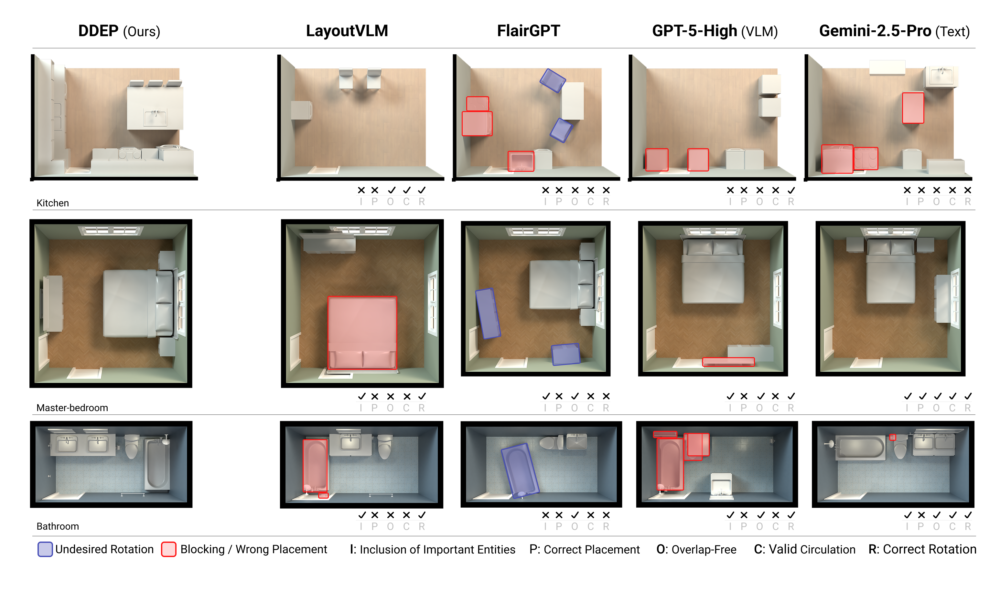
</p>

**Small Building Model (SBM)** is an encoder-decoder Transformer that generates functionally correct and semantically coherent layouts given a room envelope. Each row shows a different room type. Our approach outperforms general-purpose LLMs/VLMs and domain-specific methods.

The demo video plays on the [project page](https://manuelladron.github.io/sbm/#video) (file: [`static/video/SBM-DDEP-Turbo_no_intro.mp4`](static/video/SBM-DDEP-Turbo_no_intro.mp4)).

---

## Abstract

We present a **BIM-native tokenization** for room-level layout synthesis in Building Information Modeling (BIM) scenes. The core contribution is representational: we encode each room as a sequence of **BIM-Token Bundles**, realized as columns of a **sparse attribute&ndash;feature matrix** that unifies categorical and continuous attributes of walls, openings, and entities under **wall-referenced** (translation/scale-invariant) coordinates.

A **mixed-type embedding module** produces a unified token vector from this matrix; a single Transformer backbone is then trained in two modes: **encoder-only** for room embeddings and retrieval, and **encoder&ndash;decoder** for autoregressive entity placement, which we call **Data-Driven Entity Prediction (DDEP)**. On a controlled same-data benchmark with shared ontology and evaluation harness, DDEP outperforms ATISS and BLT baselines bridged into our representation, with ablations identifying joint continuous-feature embedding and entity ordering as primary drivers. Encoder embeddings cluster rooms by type more tightly than large general-purpose text encoders, which in turn retain an edge on within-type ranking. We frame this work as evidence that modestly sized, domain-specific sequence models over well-designed BIM tokenizations are a useful primitive for constraint-aware spatial generation, complementary to general-purpose LLMs/VLMs which we also benchmark.

---

## How Does It Work?

Our goal is to learn a unified representation for BIM scenes that enables both **retrieval** (finding similar rooms) and **generation** (placing furniture, doors, and fixtures). SBM takes as input a room envelope&mdash;walls, doors, windows&mdash;and produces either room embeddings or a complete layout with placed entities.

<p align="center">
  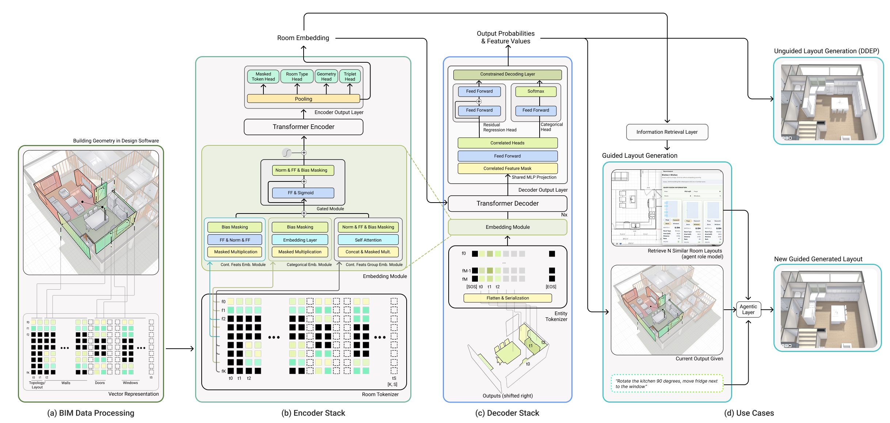
</p>

**Model Overview.** (a) BIM data extraction and assembly into a discrete set of token bundles. (b) SBM encoder stack processes the tokenized feature-attribute matrix and outputs a room representation. (c) SBM decoder stack consumes the room representation as memory to the cross-attention layers and the room entities as inputs, trained on next token prediction. (d) Downstream use cases. Retrieval and unguided layout generation (DDEP) are evaluated in the paper; the user-guided path through an agentic layer is a prospective integration that BIM-native output tokens enable but that we do not evaluate.

- **BIM-Token Bundles.** We introduce a normalized hierarchical tokenizer that encodes room topology, entity attributes, wall-referenced geometry, and relational structure into compact token bundles realized as rows of a sparse attribute-feature matrix.
- **Mixed-Type Embeddings.** A unified embedding module handles both categorical and continuous features, learning joint representations that preserve the compositional structure of architectural elements.
- **Dual-Mode Backbone.** A single Transformer supports encoder-only room embeddings for retrieval and encoder-decoder DDEP for autoregressive layout generation.

<p align="center">
  
</p>

**Mixed-type embedding, step by step.** Each feature row of the sparse attribute-feature matrix has its own embedder: a lookup table for categorical features, a small MLP for continuous ones, and a joint embedding for the grouped edge endpoints. Masked cells become exact zero vectors. A gated sum then adds the features of each token down its column, never across tokens, so S tokens go in and S vectors come out, one per BIM element, ready for the Transformer encoder.

### Encoder-Only Pathway

The encoder-only pathway produces high-fidelity room embeddings that capture geometric, topological, and semantic properties. These embeddings cluster reliably by room type and topology, achieving **NMI: 0.726** (2.0&times; better than text embedding baselines) and **near-perfect type-constrained triplet accuracy (99.9%)**.

### Data-Driven Entity Prediction (DDEP)

In DDEP mode, the encoder-decoder pipeline autoregressively places room entities (props and casework) conditioned on the room envelope. DDEP produces functionally sound layouts with:

- **Near-complete inventory satisfaction** &mdash; placing required furniture and fixtures
- **State-of-the-art navigability** &mdash; ensuring walkable paths through the room
- **Lowest violation rates** &mdash; fewer collisions and boundary violations than LLM/VLM baselines

---

## Evaluation

We evaluate SBM under two complementary protocols, exactly as reported in the EUVIP&nbsp;2026 paper. The **controlled same-data benchmark** is the lead result: every method is trained from scratch on one frozen split with a shared ontology, canonical furniture dimensions and a single evaluation harness, which isolates architectural effects from data scale. The **deployment-style benchmark** compares production DDEP against zero-shot frontier LLMs/VLMs and domain-specific systems. Metrics are **Cov.** (inventory coverage&nbsp;&uarr;), **Nav** (door-to-target navigability&nbsp;&uarr;), **SR** (reachability&nbsp;&uarr;), **DF** (detour factor&nbsp;&darr;) and **OC** (overlap&ndash;clearance&nbsp;&darr;); they must be read jointly, since a sparse room can score well on OC while failing coverage and reachability.

### Controlled same-data benchmark

| Method | Cov. &uarr; | Nav &uarr; | SR &uarr; | DF &darr; | OC &darr; |
|---|---|---|---|---|---|
| ATISS *(same-data)* | 40.8 &plusmn; 23.6 | &minus;30.3 &plusmn; 24.0 | 0.03 | 0.97 | **0.5** |
| BLT *(same-data)* | 17.8 &plusmn; 20.4 | &minus;18.6 &plusmn; 42.7 | 0.12 | 0.88 | 35.7 |
| **DDEP (ours)** | **54.9 &plusmn; 38.3** | **14.6 &plusmn; 56.0** | **0.36** | **0.60** | 13.4 |
| *DDEP ablations* | | | | | |
| &emsp;Wall-only | 50.8 | 9.6 | 0.32 | 0.63 | 12.7 |
| &emsp;No continuous groups | 42.6 | 0.7 | 0.25 | 0.69 | 13.4 |
| &emsp;No edge coordinates | 56.7 | 14.4 | 0.35 | 0.60 | 14.5 |
| &emsp;Order: *t* first | 42.6 | 4.1 | 0.29 | 0.70 | 10.6 |
| &emsp;Order: edge, *t* desc. | 46.5 | 7.8 | 0.31 | 0.66 | 13.4 |

Shared 1,225-room geometry-valid test subset. ATISS's near-zero OC reflects sparse outputs that avoid collisions while leaving almost all targets unreachable; BLT shows the opposite failure mode. Removing the joint continuous-group embedding is the single most damaging change, which is the paper's central evidence that the representation &mdash; not model scale &mdash; drives performance. ATISS and BLT outputs are bridged into our wall-referenced format; that bridge is applied to the baselines but not to DDEP, so part of the gap may reflect conversion loss.

### Deployment-style benchmark vs. frontier models

| Method | Cov. &uarr; | Nav &uarr; | OC &darr; | Latency (s) &darr; |
|---|---|---|---|---|
| *Text-only LLMs* | | | | |
| Claude Opus 4.6 | 58.9 | &minus;0.8 | 11.3 | 15.6 |
| Claude Sonnet 4.6 | 64.9 | 0.3 | 10.5 | 81.2 |
| Claude Haiku 4.5 | 55.3 | 4.4 | 15.2 | 7.0 |
| GPT-5.2 <sup>&dagger;</sup> | 47.6 | 16.8 | 13.0 | 55.1 |
| Gemini 3.1 Pro <sup>&Dagger;</sup> | 63.7 | 20.5 | 9.2 | 67.1 |
| Codex 5.3 | 68.3 | 18.9 | 9.8 | 20.8 |
| Qwen 3.5 | 64.6 | 3.1 | 13.6 | 19.0 |
| *Vision-language models (floorplan-conditioned)* | | | | |
| Claude Opus 4.6 | 61.9 | 55.5 | 8.2 | 15.3 |
| Claude Sonnet 4.6 | 65.6 | 34.6 | 11.0 | 14.8 |
| Claude Haiku 4.5 | 60.7 | 25.2 | 16.2 | 6.9 |
| GPT-5.2 <sup>&dagger;</sup> | 57.0 | 34.9 | 12.1 | 101.7 |
| Gemini 3.1 Pro <sup>&sect;</sup> | 86.5 | 47.8 | 2.2 | &ndash; |
| Qwen 3.5 <sup>&dagger;</sup> | 60.7 | 27.1 | 12.8 | 84.1 |
| *Domain-specific methods* | | | | |
| LayoutVLM | &ndash; | 40.3 | 3.8 | 145.0 |
| FlairGPT | 46.6 | 28.2 | 3.9 | 1133.6 |
| **DDEP (ours)** | **98.1** | **79.2** | **1.9** | **3.18** |

50-room held-out set. All models receive the same tuned prompt with an explicit coordinate system, wall-condition guidance, a room-type-filtered entity catalog for information parity with DDEP, and a matched example of the expected output format &mdash; so the gap is not an artifact of naive prompting. It remains a *deployment floor* rather than an architectural ceiling: each model is run once per room with no best-of-*k* or chain-of-thought, and no open model is fine-tuned in-domain. <sup>&dagger;</sup>evaluated on a subset (parse success &lt;70%). <sup>&Dagger;</sup>37/50 rooms. <sup>&sect;</sup>7/50 rooms, unreliable.

| Specification | Navigability | Overlap | Clearance |
|---|---|---|---|
| **Near-Complete** Inventory Satisfaction | **State-of-the-Art** Walkable Paths | **Lowest** Collision Rate | **Lowest** Boundary Violations |

Our results demonstrate that **modestly sized, domain-specific sequence models** over well-designed BIM tokenizations can outperform much larger general-purpose systems on layout quality. DDEP delivers functionally sound layouts that satisfy design specifications while maintaining geometric validity and constraint satisfaction.

---

## Room Embeddings

In encoder-only mode, SBM produces high-fidelity room embeddings that capture geometric, topological, and semantic properties. We compare against strong text embedding baselines (E5-Large-v2, BGE, GTE) on clustering quality and type-constrained retrieval.

<p align="center">
  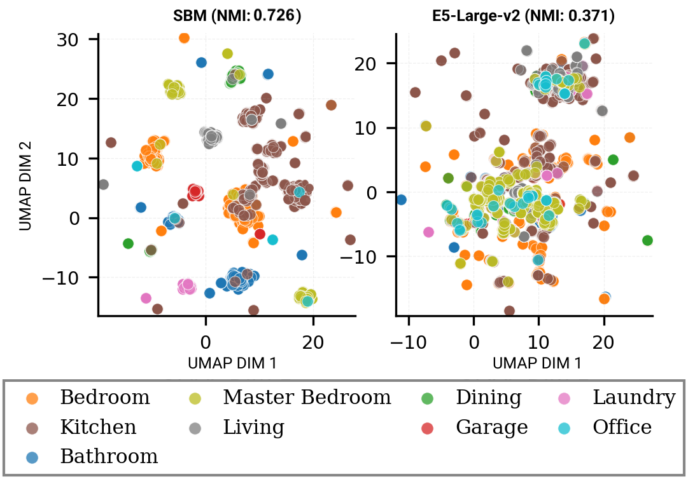
</p>

**UMAP visualization of room embeddings** colored by room type category. SBM embeddings (left, NMI 0.726) form well-separated clusters with distinct boundaries between room types, while E5-Large-v2 embeddings (right, NMI 0.371) show intermingled clusters with blurred boundaries. The roughly 2&times; higher NMI reflects SBM's specialization in geometric and spatial structure rather than lexical similarity.

| NMI Score | Triplet Accuracy | Entity Overlap |
|---|---|---|
| **0.726** | **99.9%** | **77.0%** |
| 2.0&times; better than text baselines | Type-constrained retrieval | Retrieved rooms share similar furniture |

---

## Layout Generation Examples

SBM autoregressively places entities across diverse room types. Four of the twelve room types are shown here; the [project page](https://manuelladron.github.io/sbm/) shows all of them.

| Kitchen | Laundry | Full bath | Office |
|---|---|---|---|
| 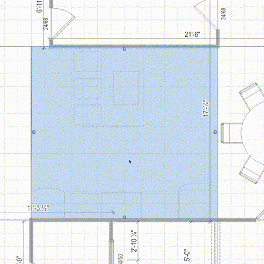 | 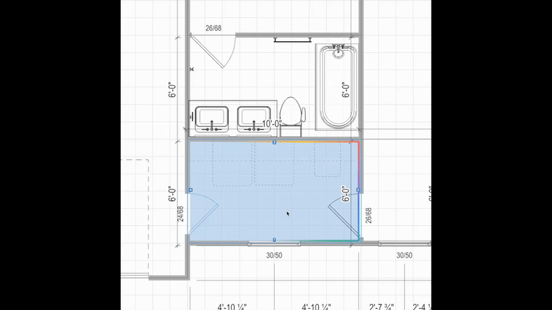 | 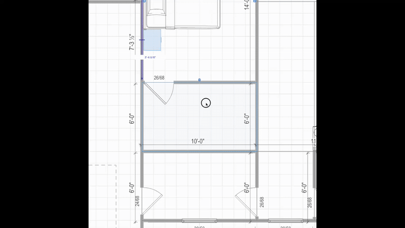 | 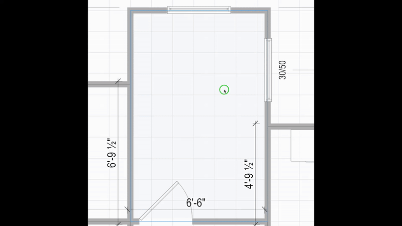 |

---

## Gallery

| | |
|---|---|
| 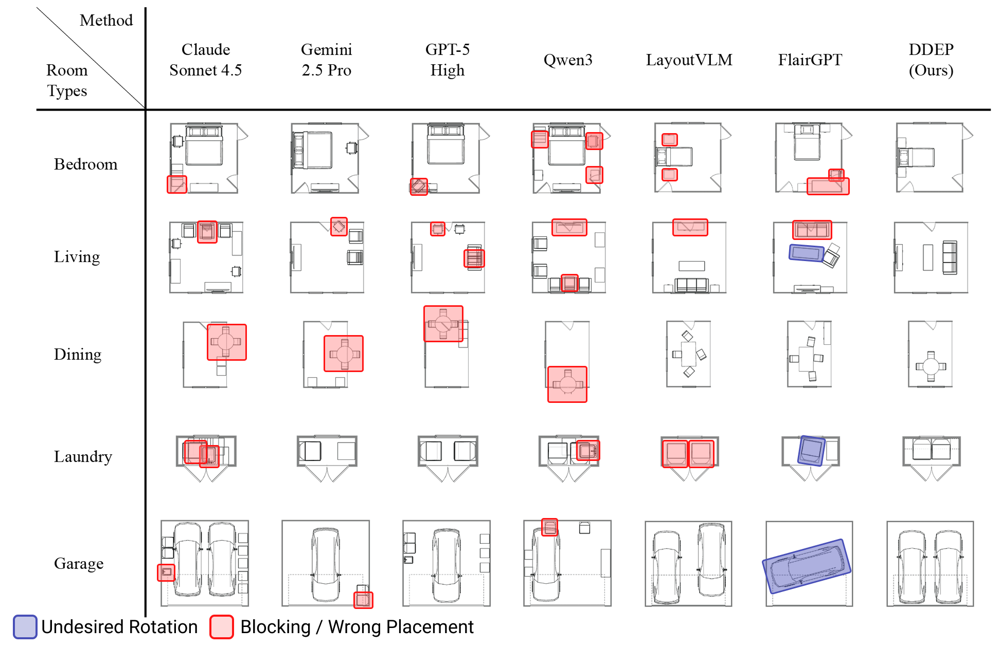 | 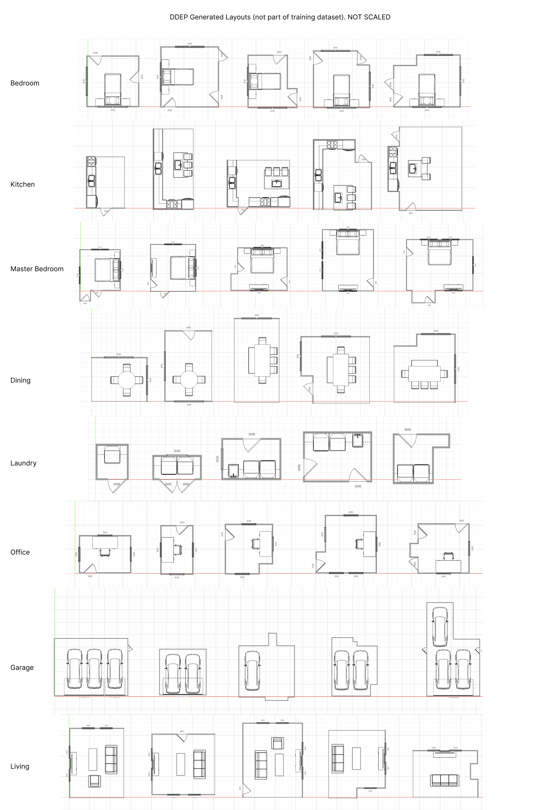 |
| 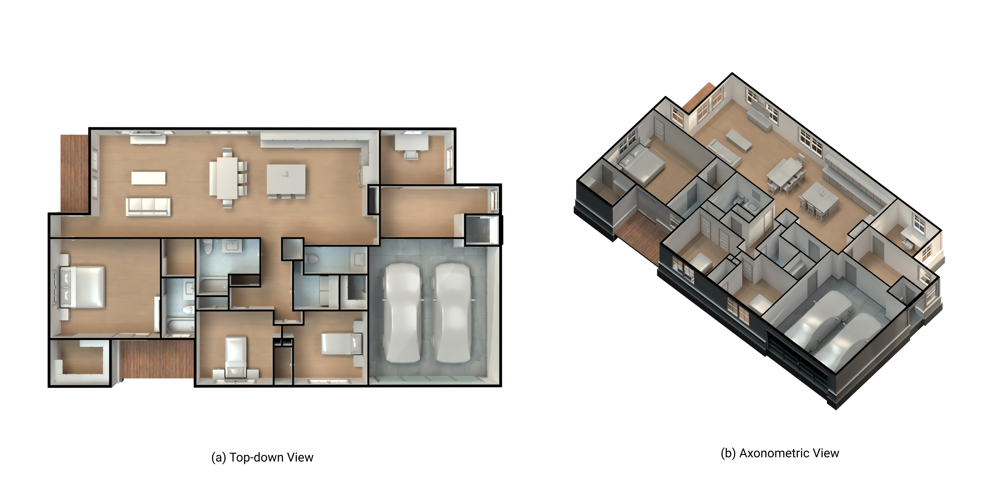 | 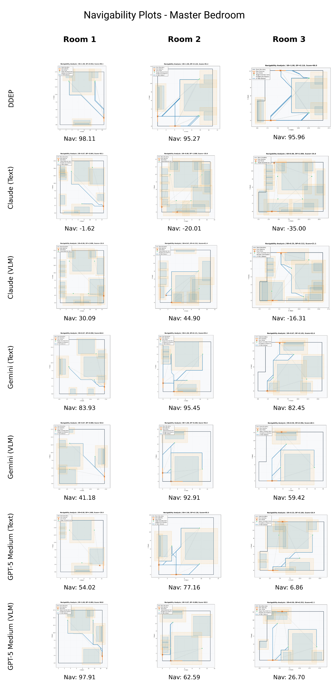 |

---

## Key Contributions

1. **Normalized Hierarchical Tokenization.** A BIM tokenization scheme with a mixed-type embedding module that unifies categorical and continuous architectural features.
2. **Unified Transformer Backbone.** SBM supports both retrieval (encoder-only) and generative layout synthesis (encoder-decoder DDEP) in a single architecture.
3. **Comprehensive Evaluation.** Rigorous benchmarks on a professional BIM dataset demonstrating superior scene coherence, geometric validity, and constraint satisfaction.
4. **Domain-Specific Excellence.** Modestly sized, domain-specific models over well-designed tokenizations outperform much larger general-purpose systems on layout quality.

---

## Citation

```bibtex
@inproceedings{sbm2026euvip,
  title={BIM-Native Tokenization for Constraint-Aware Room Layout Synthesis},
  author={Ladron de Guevara, Manuel and Rhee, Jinmo and Bidgoli, Ardavan and Razgaitis, Vaidas and Bergin, Michael},
  booktitle={Proceedings of the 14th European Conference on Visual Information Processing (EUVIP)},
  year={2026},
  eprint={2512.04832},
  archivePrefix={arXiv},
  primaryClass={cs.CV}
}
```

---

## Website

This repository holds the project page, served by GitHub Pages from `main` at <https://manuelladron.github.io/sbm/>. It is a static site with no build step:

- `index.html`: the page.
- `static/css/index.css` and `static/js/index.js`: page styles and interactions (vanilla JS, no framework).
- `static/css/webds/`: design tokens vendored from `@higharc/web-ds`. To refresh them after a version bump, run `npm install && npm run sync-webds` (needs GitHub Packages access to the `@higharc` scope, see `.npmrc`).
- `static/paper/`: paper, supplementary and talk slides. `static/video/`, `static/gifs/`, `static/images/`: media.

To preview locally:

```bash
python3 -m http.server 8000
```

Then open `http://localhost:8000` in your browser.

---

## License

This website template is licensed under [CC BY-SA 4.0](http://creativecommons.org/licenses/by-sa/4.0/).

Website template based on [Nerfies](https://nerfies.github.io/).
